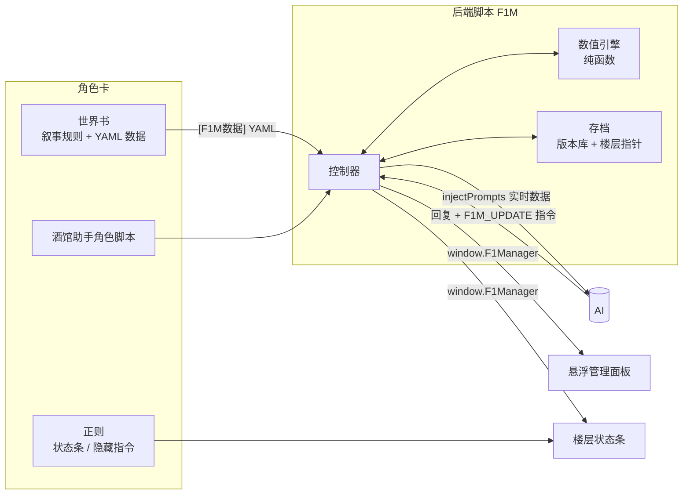

# F1 领队模拟器（SillyTavern 角色卡 · 框架版）

玩家扮演 F1 车队领队（Team Principal）的 SillyTavern 角色卡。
数值由「酒馆助手」脚本里的独立引擎计算，AI 只负责叙事。卡里附带悬浮管理面板和楼层状态条。

> 当前使用 **2026 年规则**、11 支车队、完整 24 站正式赛历和六场冲刺赛。
> 多支车队拥有专属管理机制。比赛策略页同时提供车队工程师建议和可选的“完美策略 AI”悬浮窗。

成品文件（`npm run build` 生成，已提交在仓库里）：

| 文件 | 用途 |
| --- | --- |
| `dist/F1领队模拟器.png` | 角色卡（推荐导入这个，带头像） |
| `dist/F1领队模拟器.json` | 同一张角色卡的 JSON 版本 |
| `dist/f1m-backend.js` | 后端脚本（已内嵌在角色卡里，单独提供方便查看） |
| `dist/f1m-panel.html` / `dist/f1m-hud.html` | 悬浮面板 / 楼层状态条（已内嵌） |

---

## 一、酒馆助手能做什么（调研总结）

酒馆助手（Tavern Helper，仓库名 JS-Slash-Runner，本次调研版本 4.11.3）是 SillyTavern 扩展。它让角色卡可以运行 JavaScript，主要有两种形态：

1. **前端界面**：消息里的代码块只要包含 `<html>`、`<head>` 或 `<body`，就会被渲染成 iframe。
   通常用「仅格式显示」正则把一个占位符（例如 `<F1M_HUD/>`）替换成 HTML 代码块，这样界面不会发给 AI。
2. **脚本库**：在后台 iframe 里运行的 `<script type="module">`。分为全局脚本、预设脚本和角色脚本。
   角色脚本存放在角色卡的 `data.extensions.tavern_helper.scripts` 里，导入角色卡时会询问是否启用。

脚本和界面里可以直接调用的主要接口：

| 能力 | 主要接口 | 本卡的用法 |
| --- | --- | --- |
| 变量（全局 / 预设 / 角色卡 / 聊天 / 楼层 / 脚本） | `getVariables`、`replaceVariables`、`updateVariablesWith` | 存档版本放在**聊天变量**；每楼的**楼层变量**记录指针；设置放在**脚本变量** |
| 事件监听 | `eventOn(tavern_events.MESSAGE_RECEIVED, …)`、`eventEmit` | AI 回复到达后结算指令；生成前注入数据；切换聊天时重载存档 |
| 提示词注入 | `injectPrompts`、`uninjectPrompts` | 每次生成前注入「实时数据」块（深度、角色可调） |
| 助手宏 | `registerMacroLike`，以及内置的 `{{get_message_variable::…}}` | 注册 `{{f1m_state}}`，想手动摆放数据块的用户可以用 |
| 聊天楼层 | `getChatMessages`、`setChatMessages`、`createChatMessages`、`deleteChatMessages` | 在 AI 回复末尾补状态条占位符；「AI叙述」按钮发送一条消息 |
| 触发生成 | `generate`、`generateRaw`、`triggerSlash('/trigger')` | 「AI叙述」= 发送一条用户消息再触发生成 |
| 世界书 / 预设 / 角色卡 / 正则 | `getWorldbook`、`getCharWorldbookNames`、`getPreset`、`getTavernRegexes` … | 从世界书读取 `[F1M数据]` 条目里的 YAML 数据 |
| 脚本按钮 | `getButtonEvent`、`appendInexistentScriptButtons` | 输入框附近的「F1管理面板」「AI叙述」两个按钮 |
| 跨界面共享接口 | `initializeGlobal`、`waitGlobalInitialized` | 后端把 `F1Manager` 共享给状态条和面板 |
| 操作酒馆页面 | 脚本里的 `$` 就是酒馆主页面的 jQuery | 在酒馆页面上创建可拖动、可缩放的悬浮面板 |
| 其他 | 音频播放器、`toastr` 提示、内置 `_`（lodash）、`YAML`、`z`（zod）、MVU 变量框架接口、扩展管理 … | 用到 `toastr`、`YAML` |

社区常用的配套工具：

- **MVU（MagVarUpdate）**：AI 用 `_.set(...)` 更新楼层变量的变量框架。本卡没有用 MVU，而是选择了「独立引擎」：核心数值不交给 AI 改写。
- **tavern_helper_template**（StageDog）：用 TypeScript + Vue 写界面和脚本的模板，配有 `tavern_sync` 打包工具。本项目参考了它的约定，但用自己的构建脚本直接产出角色卡。
- 官方文档：<https://n0vi028.github.io/JS-Slash-Runner-Doc/>

---

## 二、安装与使用

1. 安装 SillyTavern（1.13 以上）和**酒馆助手 4.x**。
2. 导入 `dist/F1领队模拟器.png`。
   - 询问「是否导入内嵌世界书」时选**是**（数据都在里面）。
   - 打开聊天后，酒馆助手会询问是否启用角色脚本，选**允许**。SillyTavern 询问是否启用角色正则时也选**允许**。
3. 点击输入框附近的「**F1管理面板**」按钮，选择车队开局。
4. 在面板里安排研发、给赛车装件、设定策略，然后点「▶」推进赛程：
   季前 → 赛前 → 练习赛 → （冲刺排位 → 冲刺赛）→ 排位赛 → 正赛 → 赛后 → 下一站。
   正赛阶段也可以选择「开始实时正赛」：比赛会保存为可恢复的逐圈状态，并在发车、进站机会、天气变化、安全车 / VSC 与事故后暂停。面板只显示当前天气、短期不确定预报、公开计时和本队遥测；确认两车指令后才会继续。
5. 模拟出的结果会进入「待叙述事件」。下一条 AI 回复会把它们写进剧情；也可以点「**AI叙述**」主动让 AI 讲述。

### 副 API 设置

打开「F1管理面板」→「更多」→「存档与设置」。在设置区选择「副 API」，然后填写：

- **副 API 站点**：OpenAI 兼容地址，例如 `https://api.example.com/v1`。
- **副 API Key**：服务商提供的 Key。
- **副 API 模型**：服务商支持的模型名称。

也可以只填写酒馆助手已有的「代理预设名称」。代理预设存在时，酒馆助手会优先使用该预设。
Key 仅保存在本设备浏览器中，不会写入角色卡、游戏存档或导出的存档文件。
同一 SillyTavern 站点中的其他脚本仍可能访问浏览器数据。不要在共享设备上保存 Key。

### 领队能做的决定（都会反映到数值和剧情里）

| 决定 | 影响 |
| --- | --- |
| **升级件分配**：新零件只有 1~2 件时先装给谁 | 两台车性能出现差距；正赛前吃亏的车手心态和信任下降，自尊心越强越明显 |
| **优先车手** | 被选中者心态、信任上升，队友不满；车队指令的「偏向」更常用 |
| **研发方案**：保守 / 标准 / 激进、是否加急 | 花费、周期、风洞时长、收益区间与风险。激进方案可能出现负收益（关联性问题） |
| **练习赛项目**：调校 / 长距离 / 排位模拟 / 新件测试 | 调校信心、轮胎数据、排位加成；新件测试会提前揭晓新零件的真实性能 |
| **排位方案**：稳妥 / 标准 / 激进 | 单圈速度与失误率的取舍 |
| **轮胎策略**：自动或指定停站方案 | 引擎会给出每个方案的预测耗时差 |
| **驾驶模式、进站时机、安全车机会进站** | 圈速、轮胎衰减、故障/失误风险，以及 Undercut / Overcut |
| **车队指令**：自由比赛 / 保持位置 / 偏向某人 | 让车是否被执行取决于车手的自尊心和信任；抗命会引发车库冲突 |
| **实时正赛指挥**：轮胎、进站、前翼维修、节奏、能量与车队指令 | 只对下一未完成圈生效；可在每个关键窗口为两台车联合确认 |
| **合同市场**：正式车手 / 替补与五类员工的合同、买断、解约 | 直接报价以公开需求、年薪、年限与公开车队实力确定接受或拒绝；预计阵容在市场关闭后生效 |
| **设施升级、维修组训练、车手模拟器训练、下赛季投入** | 研发效率、进站速度、车手成长、新车起点 |

### 法拉利：过渡领队（专属机制）

背景设定：2025 年底，恩里科·瓜尔蒂耶里主导的 2026 钢制气缸盖方案失败，SF-25 赛季也很糟。埃尔坎因此解除了瓦塞尔的领队职务，把 2026 年定为过渡年，并从外部请来一位过渡领队（玩家）。开局时可以在「你为什么被选中？」里写下理由（可选，最多 300 字），AI 会把它写进开场剧情。

| 指标 | 规则（数值都可在 `[F1M数据] 规则` 的 `ferrari` 中修改） |
| --- | --- |
| **媒体支持率** | 开局 45。每站正赛后固定 −1，成绩带来的涨跌 ×1.5。低于 30 警告，低于 20 撤职 |
| **粉丝意见**（汉密尔顿 / 勒克莱尔，各 0~100） | 升级件分配、优先车手、车队指令让车、换下车手、正赛成绩（队内名次、领奖台、机械故障）都会改变两边的意见。差距超过 25 警告，超过 35 撤职 |
| **适应期** | 第一个赛季的前 2 站只警告、不撤职 |
| **撤职** | 正赛后检查。撤职后存档锁定，只能读档重来 |

AI 可以用 `{"op":"fans","driver":"hamilton","delta":3}` 指令表达剧情对粉丝意见的影响（单条消息每位车手最多 ±6）。

### 2026 规则要点

- 排位赛 22 台车按 6/6/10 淘汰（`qualiFinalists`）。
- DRS 取消，改为**超车模式**：落后前车 1 秒内获得额外电能，收益随能量回收系统性能浮动；驾驶模式「进攻」相当于主动使用 **Boost**。
- 零件「动力单元」拆分为**内燃机**和**能量回收系统**。每位车手每赛季可用内燃机 4 台、能量回收系统 3 套；超出后第一次罚退 10 位，之后每次 5 位。换回本赛季用过的旧件不计数，事故后换上的备件计数。
- 前翼、尾翼按主动空力命名。

### 存档规则

- 存档**跟随楼层**：重 roll、删除楼层、切换 swipe 都会自动回到那一楼当时的状态。
- 面板操作挂在**当前最新楼层**。如果在面板里操作之后又重 roll 这一楼，这些操作会跟着旧 swipe 一起回滚。
- 同一楼层上连续的面板操作合并成一个版本。默认最多保留 30 个版本（可在设置里调整），近期楼层引用的版本不会被清理。
- 「存档与设置」页可以读档（把旧版本挂到最新楼层）、导出 / 导入存档 JSON、查看注入给 AI 的数据。

---

## 三、系统设计



- **数值引擎**（`src/engine/`）：纯 TypeScript、可在 Node 中测试。随机数可复现（种子存在存档里），同一存档加同一决策会得到同一结果。也可以在开局时选择「每次重抽」。
- **控制器**（`src/tavern/controller.ts`）：把引擎接到酒馆事件上。
  - AI 回复到达时，解析 `<F1M_UPDATE>` 白名单指令（心态、信任、体能、董事会、媒体、士气、小额资金、新闻、罚退、剧情标记），按上限裁剪后结算。
  - 赛车性能、零件、比赛结果，AI 都无权修改。
- **存档**（`src/tavern/store.ts`）：
  - 每次状态变化生成一个版本，完整快照用 lz-string 压缩后存进聊天变量。
  - 变化发生的那一楼（当前 swipe）记录版本指针。
  - 读取某一楼的状态 = 往前找最近的指针。
- **前端**：
  - 悬浮面板（`src/ui/panel/`）用 Vue 3 编写，打包成单个 HTML，由后端以 iframe 的方式挂到酒馆页面。
  - 状态条（`src/ui/hud/hud.html`）用原生 JS 编写，通过正则渲染在每条 AI 回复下面。

### 数值模型（简述）

- **车手**：速度、缠斗、稳定、轮胎管理、雨战、技术反馈，加上潜力、心态、信任、体能、状态、自尊心。排位和正赛使用不同的能力加权，心态和体能会带来临场修正。年龄决定成长或衰退。
- **赛车**：9 类零件（内燃机、能量回收系统、变速箱、底盘、前翼、尾翼、底板、侧箱、悬挂），每台车独立装件。
  零件性能按权重合成为下压力、气动效率、动力、机械抓地、轮胎友好度和可靠性，再按赛道需求加权得到「本站适配分」。
- **研发**：收益受零件当前水平（越高越难提升）、技术总监和空动主管、风洞 / CFD / 工厂等级影响。真实收益在开工时就已抽取，但要上赛道验证后才揭晓。研发受预算帽、风洞时长（排名越靠后越多）和研发槽位限制。AI 车队使用同一套研发规则。
- **比赛**：逐圈模拟。
  - 圈速 = 赛车 + 车手 + 调校 + 轮胎衰减（含悬崖）+ 油量 + 驾驶模式 + 随机。
  - 超车由超车模式（2026 取代 DRS）、Boost、赛道超车难度和缠斗能力决定。
  - 进站会出现慢进站；事故、机械故障、安全车 / VSC 都会发生。撞车会损毁零件（前翼最常见）。
  - 车队指令在模拟中生效。
- **财务**：周薪、每站运营成本与赞助收入、赛季末奖金、预算帽；董事会信心按成绩与目标变化。

---

## 四、填写正式数据

数据在世界书里名字以 `[F1M数据]` 开头的条目中（YAML 格式）。这些条目处于禁用状态，不会发给 AI，只供脚本读取：

| 条目 | 内容 |
| --- | --- |
| `[F1M数据] 规则` | 积分、预算帽、零件定义、轮胎、研发方案、AI 指令上限……（只写想改的字段） |
| `[F1M数据] 车队` | 车队、设施、员工、初始零件性能、董事会目标 |
| `[F1M数据] 车手` | 车手能力、潜力、性格、合同、所属车队（`role: race / reserve`） |
| `[F1M数据] 赛道` | 圈数、参考圈速、进站损失、属性需求权重、超车难度、轮胎负荷、天气 |
| `[F1M数据] 赛历` | 比赛顺序、冲刺赛、间隔周数 |

- 每个条目里都有逐字段的中文注释，按注释替换即可。
- 数据可以拆成任意多个条目，只要名字以 `[F1M数据]` 开头，列表会按 `id` 合并。
- 面板的开局页会显示数据检查结果（错误会阻止开局，并给出条目与字段路径）。
- 车手、车队、赛道的叙事资料（性格、背景、说话方式）建议写成普通的绿灯条目，可以复制 `[F1M资料] 车手资料模板`。
  实时数据里出现名字时会自动触发这些条目。

修改数据后，已有存档不受影响（存档是自包含的）；新开局才会使用新数据。

---

## 五、开发

```bash
npm install
npm test          # 引擎单元测试 + 控制器集成测试 + 打包产物冒烟测试
npm run build     # 生成 dist/ 下的角色卡、后端脚本和界面
npm run dev       # 本地开发页：模拟酒馆环境，跑真实后端 + 面板 + 状态条（先 build 一次）
```

本地开发页（`dev/`）在浏览器里模拟酒馆助手接口、聊天楼层、swipe 与 AI 回复，不需要安装 SillyTavern 就能调试面板和状态条。

```text
src/engine/     数值引擎（类型、数据校验、开局、评分、研发、周末、比赛、赛季、AI 协议、提示词、视图）
src/tavern/     酒馆适配层（环境绑定、存档、控制器、对外接口、悬浮面板宿主、脚本入口）
src/ui/panel/   悬浮管理面板（Vue 3）
src/ui/hud/     楼层状态条（原生 HTML/JS，作为正则替换串内嵌）
src/card/       角色卡文本、世界书条目、头像
scripts/        构建脚本（组装 chara_card_v3 JSON 与 PNG）
tests/          Vitest 测试
dev/            本地开发页
```

### 已知限制 / 后续可扩展

- 合同续约、转会、车手市场和五类员工招聘已经实现。休赛期市场使用确定性报价，并支持自由人员、买断、解约与 AI 车队补缺。
- 正赛与冲刺赛已经支持可恢复的逐圈模拟、隐藏动态天气、短期不确定预报，以及进站、天气、SC/VSC 和事故决策窗口。
- 动力单元配额只按「内燃机 / 能量回收系统」两类计数，没有细分到涡轮、MGU-K、电池等单个元件。
- 角色卡包含 11 支车队、2026 车手阵容、完整 24 站赛历，以及各特殊车队的世界书背景和管理机制。
- 没有群聊支持；每个聊天文件一份存档。
